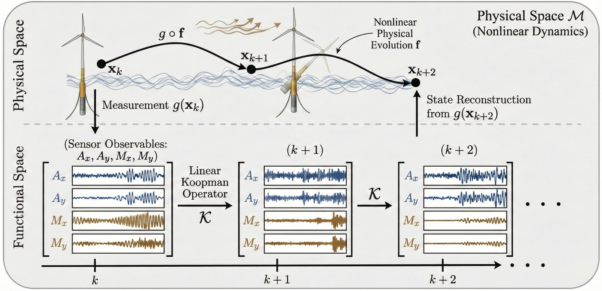

# Equation-free Koopman (Hankel-DMD) models for floating offshore wind turbines

Reference implementation of the paper *Equation-Free Digital Twins for Nonlinear Structural Dynamics*
(Abaei et al., arXiv:2605.00950; revised version under review). One Hankel-DMD approximation of the Koopman
operator, identified offline from delay-embedded measurements, provides

* **operational modal parameters**: tower frequencies, damping ratios and mode shapes (correlation-domain
  identification for damping estimation), and
* **virtual sensing**: reconstruction of unmeasured channels for any pattern of failed sensors without retraining,
  by a Tikhonov-regularised projection (the estimator of the framework) or its Kalman form (stochastic extension).

The method is assessed on OpenFAST simulations of the NREL 5-MW OC3-Hywind spar (12 wind-wave load cases,
time-blocked validation) and verified on basin-test data of the FOCAL Campaign IV 1:70 IEA 15-MW semisubmersible.

<p align="center"></p>

## Repository layout

```
src/eftwin/            the method, one implementation for any number of channels p and delay d
  hankel.py            delay Gram sums (Hankel matrices are never formed), fold statistics
  dmd.py               exact Hankel-DMD, modal parameters, modal energy, pole selection, correlation functions
  estimators.py        projection (Tikhonov) and Kalman form, nowcast and forecast
  model.py             high-level API: identify_modes, fit_hankel_dmd, ProjectionEstimator, KalmanEstimator
  validation.py        time-blocked folds, sufficient statistics, cross-fitting, R^2/NRMSE, coherence bound
  baselines/           comparison methods: oma.py (SSI-COV, FDD), vs.py (gappy POD, static LS, Wiener filter)
  io.py, preprocess.py, modal.py, plotting.py, studies/
configs/               openfast.yaml, focal.yaml (every setting of the reported results), openfast_cases.yaml
scripts/openfast/      identification, shape check, linear reference, virtual sensing, robustness, summaries
scripts/focal/         identification, rotor-speed check, wide band, sensor kinematics, virtual sensing, bound
scripts/make_tables.py, make_figures.py, run_openfast.sh, run_focal.sh, supplementary/, simulation/
results/               saved outputs: focal/ (CSV/NPZ), openfast/ (regenerated), reference/ (paper tables and figures)
examples/quickstart.py, tests/, docs/, openfast/ (simulation templates), legacy/ (original-submission scripts)
```

## Installation

```bash
git clone https://github.com/Mahdi22223/FOWT-Digital-Twin.git && cd FOWT-Digital-Twin
pip install -e .            # or: conda env create -f environment.yml && conda activate eftwin
python -m pytest            # a few seconds
```

## Quickstart

```python
from eftwin import identify_modes, fit_hankel_dmd, ProjectionEstimator, KalmanEstimator

# segments: list of band-passed training records (N_i, p), one per load case or run; dt in seconds
# Y: band-passed record (N, p) in which only the active columns are used (here sensor 8)
f, zeta, E, mu, Phi = identify_modes(segments, d=60, r=24, dt=0.05)        # correlation-domain poles
model = fit_hankel_dmd(segments, d=60, r=70)                               # one model for every layout
y_hat = ProjectionEstimator(model, active=[8], alpha=0.01).estimate(Y)     # causal estimate of all channels
y_hat = KalmanEstimator(model, active=[8]).estimate(Y)
```

`python examples/quickstart.py` runs this on synthetic data in about two seconds.

## Reproducing the paper

Data are not stored in the repository; see [data/README.md](data/README.md). With the data in place:

```bash
bash scripts/run_openfast.sh      # Sections 3-4: Tables 3-5, A1-A4, Figs. 5-13, A1
bash scripts/run_focal.sh         # Section 5: Tables 6-7, Figs. 14-16
```

Without the raw data, the FOCAL tables and Fig. 14 rebuild from the saved outputs in `results/focal`:
`python scripts/make_tables.py focal_sysid focal_vs` and `python scripts/make_figures.py fig14`.

For the OpenFAST linear reference, the verified operating point is 8 m/s steady inflow at `t = 100 s`, still water,
MAP++ mooring, SubDyn enabled (`CompSub = 1`), with the rotor nearly stationary at 0.1801 rpm. The generated `.lin`
is authoritative; the historical InflowWind filename containing `Steady12mps` is misleading.

[docs/reproduce.md](docs/reproduce.md) maps every table and figure to its script and output file, and
`results/reference/` holds the tables and figures of the revised paper for comparison.

The implementation reproduces the finalized revision code: unit-level against its outputs
(`tests/test_revision_equivalence.py`) and end to end, where both pipelines gave identical tables, figures and
intermediate files on synthetic data ([docs/reproduce.md](docs/reproduce.md)). Where the two studies used different
conventions (for example the SSI-COV pole selection), both are kept as named options and documented in
[docs/method.md](docs/method.md).

## Original submission

The repository state of the original submission is tagged `v0.2-original-submission`. The scripts that produced
the original-submission results are kept unchanged in [legacy/](legacy/README.md). The supplementary video on
Zenodo ([10.5281/zenodo.20110438](https://doi.org/10.5281/zenodo.20110438)) shows that version.

## Citation

> Abaei, M. M., BahooToroody, A., Polojärvi, A., Remes, H., Tygesen, U. T., Suominen, M., and Beer, M. (2026).
> *Equation-Free Digital Twins for Nonlinear Structural Dynamics*. arXiv:2605.00950.

Software: [10.5281/zenodo.20110415](https://doi.org/10.5281/zenodo.20110415). See also `CITATION.cff`.

## License

MIT (code and documentation). The NREL 5-MW baseline files and the FOCAL data are distributed by their owners
under their own terms.
